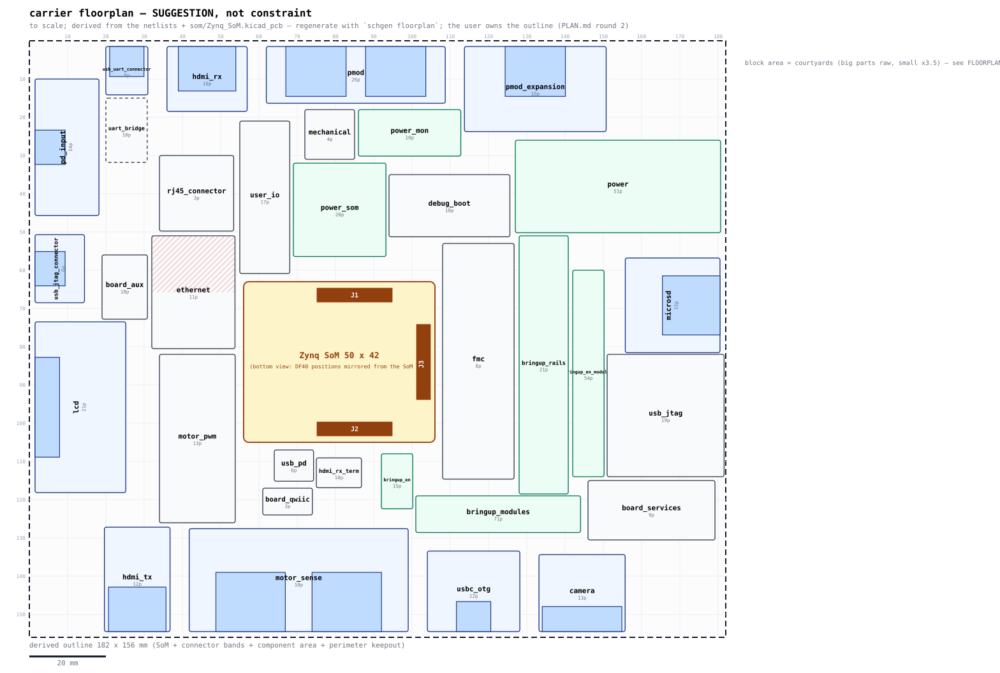

# Floorplan

## Sources (everything derived, nothing invented)

- SoM outline + connector positions: `som/Zynq_SoM.kicad_pcb` (Edge.Cuts bbox + connector footprints, parsed live)
- block sizes: per-part courtyards (`parts/<MPN>/<MPN>.kicad_mod` F.CrtYd; KiCad-standard footprints from the dims in their names), big parts raw + small parts x3.5 routing factor
- edge pinning + zones: connector parts in each sheet netlist + linker module-connector bindings (incl. `expect=` deferrals)
- electrical notes: `native/src/constraints.cpp` (JLC06161H-3313), `native/src/power_checks.cpp` analysis, typed ports (1.8V SDIO)

## Extracted SoM geometry

SoM outline: **50 x 42 mm**.

| conn | SoM PCB `(at)` | carrier-top view (SoM-rel) | pad extent |
|---|---|---|---|
| J1 | (136.5, 94.5) rot 180 | (29, 3.5) | 19.8 x 3.78 mm |
| J2 | (136.5, 129.5) rot 180 | (29, 38.5) | 19.8 x 3.78 mm |
| J3 | (154.5, 112) rot 90 | (47, 21) | 3.78 x 19.8 mm |

Derived board: **190 x 159 mm**; SoM origin at **(60, 64.5)** (centered). All coordinates below are board-frame mm, origin top-left, +y down (KiCad convention).

Outline derivation: SoM 50x42 + 7mm halo + 11mm connector band/edge -> core 86x78; component area 7759mm2 / 0.6 fill -> area floor 135x122; + 3mm perimeter keepout -> 145x130 mm (rounded up to 5mm grid); then bounded search over aspects 1, 1.1, 1.1154, 1.2, 1.3, 1.4 -> 190x159 mm (the smallest feasible board FOUND by this bounded aspect/grid search and greedy packing order, not a global minimum; holding the REAL 2-sided packed blocks with the estimated cross-subsystem airwire 18298 mm; advisory airwire reference 17207 mm, not an acceptance constraint), SoM 50x42 centered.

## Edge connectors (pinned to edges by their mating direction)

| edge | sheet | block (x, y, w x h) | connector(s) | notes |
|---|---|---|---|---|
| N | usb_jtag_connector | (13.337, 1.5, 11.2451 x 18.6891) | TYPE-C-31-M-12 (USB-C receptacle) |  |
| N | pmod | (29.5821, 1.5, 46.765 x 14.839) | DS1024-2x6R2 (PMOD 2x6 socket), DS1024-2x6R2 (PMOD 2x6 socket) |  |
| N | usbc_otg | (81.3471, 1.5, 25.1549 x 23.2682) | TYPE-C-31-M-12 (USB-C receptacle) |  |
| N | lcd | (111.502, 1.5, 51.885 x 19.4469) | AFC07-S40FCA-00 (FFC 40-pin 0.5mm (LCD)) |  |
| W | pd_input | (1.5, 25.8863, 16.6982 x 36.2062) | TYPE-C-31-M-12 (USB-C receptacle) |  |
| W | camera | (1.5, 67.0925, 16.0301 x 29.5751) | SFW15R-1STE1LF (FFC 15-pin 1mm (camera)) |  |
| W | pmod_expansion | (1.5, 101.668, 13.19 x 46.6324) | DS1024-2x6R2 (PMOD 2x6 socket) |  |
| E | usb_uart_connector | (177.477, 77.1424, 11.0232 x 16.7151) | TYPE-C-31-M-12 (USB-C receptacle) |  |
| S | hdmi_rx | (33.5391, 140.7, 24.2225 x 16.8001) | HDMI-019S (HDMI receptacle) |  |
| S | hdmi_tx | (77.7616, 130.197, 17.1547 x 27.3027) | HDMI-019S (HDMI receptacle) |  |
| S | microsd | (99.9163, 130.653, 20.185 x 26.8467) | TF-01A (microSD push-pull) |  |
| S | motor_sense | (125.101, 131.288, 54.7251 x 26.212) | XT60PW-M (XT60 ESC power inlet (horizontal)), XT60PW-M (XT60 ESC power inlet (horizontal)) |  |

## Interior blocks (zone = dominant SoM connector side, or the power cluster)

| sheet | anchor | block (x, y, w x h) | parts | est mm2 | notes |
|---|---|---|---|---|---|
| board_aux | E | (101, 119, 25.7 x 10.76) | 18 | 276.5 |  |
| board_qwiic | E | (78, 122, 12.3141 x 7.5101) | 3 | 92.5 |  |
| board_services | E | (25, 119, 35.81 x 16.05) | 11 | 574.8 |  |
| bringup_en | E | (92, 109, 8.2 x 14.4) | 15 | 118.1 |  |
| bringup_en_modules | E | (128, 48, 8.2 x 54) | 54 | 442.8 |  |
| bringup_modules | E | (98, 36, 44.1 x 10.63) | 71 | 468.8 |  |
| bringup_rails | E | (113, 48, 13.34 x 70.56) | 21 | 941.3 |  |
| debug_boot | N | (19, 64, 18.76 x 37.63) | 10 | 705.9 |  |
| ethernet | N | (137, 70, 21.745 x 29.7676) | 11 | 647.3 |  |
| fmc | E | (39, 55, 18.935 x 61.63) | 8 | 1167 |  |
| hdmi_rx_term | @hdmi_rx | (79, 110.59, 11.805 x 7.805) | 10 | 92.1 |  |
| mechanical | E | (144, 33, 13 x 13) | 4 | 169 |  |
| motor_pwm | @motor_sense | (130, 110, 45.3101 x 20.05) | 13 | 908.5 |  |
| power | E | (165, 21, 24.44 x 53.6604) | 51 | 1311.5 |  |
| power_mon | E | (108, 22, 35.4666 x 12.6785) | 10 | 449.7 |  |
| power_som | E | (73, 33, 24.4202 x 24.44) | 20 | 596.8 |  |
| rj45_connector | E | (137, 48, 20.41 x 20.77) | 3 | 423.9 |  |
| uart_bridge | @usb_uart_connector | (166, 77, 10.805 x 16.78) | 10 | 181.3 |  |
| usb_jtag | E | (40, 23, 32.512 x 30.8202) | 19 | 1002 |  |
| usb_pd | @pd_input | (98, 52, 8.18 x 10.28) | 6 | 84.1 |  |
| user_io | S | (62, 109, 13.56 x 41.87) | 17 | 567.8 |  |

## Routing constraint classes (JLC06161H-3313 — from native/src/constraints.cpp)

| class | nets | geometry (track/gap mm) | match budget |
|---|---|---|---|
| DP100_DIFF | 50 | 0.1148 / 0.2032 | intra-pair <= 0.127..1.27 mm; inter-pair <= 0.127..1.27 mm |
| DP100_TMDS | 16 | 0.1148 / 0.2032 | intra-pair <= 2.9972 mm; inter-pair <= 2.9972 mm |
| DP90_USB | 8 | 0.1455 / 0.2032 | intra-pair <= 3.81 mm; inter-pair <= 3.81 mm |
| I2C | 10 | - | - |
| SD_1V8 | 6 | - | bus to CLK <= 2.5 mm (policy) |

Full per-net table: `carrier/manufacturing/layout_constraints.csv` (+ the `.kicad_dru` rules).

## Power and thermal (worst-case declared draws — powertree analysis)

| regulator | sheet | rail | I out (A) | est dissipation |
|---|---|---|---|---|
| SY6280AAC (U1) | board_aux | +3V3 -> +3V3_AUX | 0.211 | negligible |
| SY6280AAC (U1) | bringup_modules | +3V3 -> +3V3_HDMI_TX | 0.006 | negligible |
| SY6280AAC (U10) | bringup_modules | +5V -> +5V_LCD | 0.453 | negligible |
| SY6280AAC (U2) | bringup_modules | +3V3 -> +3V3_HDMI_RX | 0.005 | negligible |
| SY6280AAC (U3) | bringup_modules | +3V3 -> +3V3_LCD | 0.104 | negligible |
| SY6280AAC (U4) | bringup_modules | +3V3 -> +3V3_CAM | 0.304 | negligible |
| SY6280AAC (U5) | bringup_modules | +3V3 -> +3V3_SD | 0.254 | negligible |
| SY6280AAC (U6) | bringup_modules | +5V -> +5V_USB | 0.503 | negligible |
| SY6280AAC (U7) | bringup_modules | +3V3 -> +3V3_PMOD | 0.204 | negligible |
| SY6280AAC (U8) | bringup_modules | +3V3 -> +3V3_USER_LED | 0.016 | negligible |
| SY6280AAC (U9) | bringup_modules | +5V -> +5V_HDMI_TX | 0.058 | negligible |
| TLV75725PDYDR (U1) | fmc | +3V3 -> +2V5_VADJ | 0.400 | ~0.32 W |
| SY6280AAC (U3) | motor_pwm | +5V -> +5V_MOTOR_IO | 0.000 | negligible |
| TPS26631PWPR (U1) | pd_input | +VBUS_IN -> +VIN | 1.319 | negligible |
| SY6280AAC (U1) | pmod_expansion | +3V3 -> +3V3_PMODX | 0.104 | negligible |
| LM61460AANRJRR (U1) | power | +VIN_SYS -> +5V_REG | 2.744 | ~1.52 W |
| LM61460AANRJRR (U2) | power | +5V -> +3V3_REG | 2.245 | ~0.82 W |
| AP2112K-1.8 (U3) | power | +3V3 -> +1V8_REG | 0.006 | negligible |
| LM61460AANRJRR (U4) | power_som | +VIN_SYS -> +5V_SOM | 2.154 | ~1.11 W |
| AP2112K-3.3TRG1 (U4) | usb_jtag | +5V_DBG -> +3V3_DBG | 0.045 | ~0.08 W |

Numbers are the power-tree gate's worst-case declared draws (`carrier/reports/power_tree.txt`); regulators above ~0.3 W want copper pours + stitching vias.
