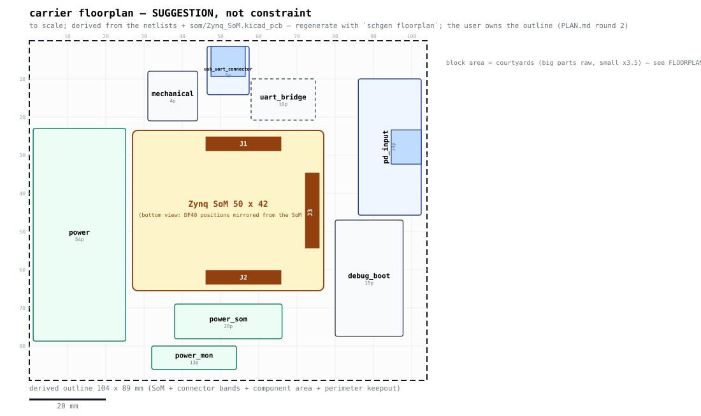

# Floorplan

## Sources (everything derived, nothing invented)

- SoM outline + connector positions: `som/Zynq_SoM.kicad_pcb` (Edge.Cuts bbox + connector footprints, parsed live)
- block sizes: per-part courtyards (`parts/<MPN>/<MPN>.kicad_mod` F.CrtYd; KiCad-standard footprints from the dims in their names), big parts raw + small parts x3.5 routing factor
- edge pinning + zones: connector parts in each sheet netlist + linker module-connector bindings (incl. `expect=` deferrals)
- electrical notes: `native/src/constraints.cpp` (JLC06161H-3313), `native/src/power_checks.cpp` analysis, typed ports (1.8V SDIO)

## Extracted SoM geometry

SoM outline: **50 x 42 mm**.

| conn | SoM PCB `(at)` | carrier-top view (SoM-rel) | pad extent |
|---|---|---|---|
| J1 | (136.5, 94.5) rot 180 | (29, 3.5) | 19.8 x 3.78 mm |
| J2 | (136.5, 129.5) rot 180 | (29, 38.5) | 19.8 x 3.78 mm |
| J3 | (154.5, 112) rot 90 | (47, 21) | 3.78 x 19.8 mm |

Derived board: **104 x 89 mm**; SoM origin at **(27, 23.5)** (centered). All coordinates below are board-frame mm, origin top-left, +y down (KiCad convention).

Outline derivation: SoM 50x42 + 7mm halo + 11mm connector band/edge -> core 86x78; component area 1139mm2 / 0.6 fill -> area floor 78x71; + 3mm perimeter keepout -> 95x85 mm (rounded up to 5mm grid); then bounded search over aspects 1, 1.1, 1.1176, 1.2, 1.3, 1.4 -> 104x89 mm (the smallest feasible board FOUND by this bounded aspect/grid search and greedy packing order, not a global minimum; holding the REAL 2-sided packed blocks with the estimated cross-subsystem airwire 1900 mm; advisory airwire reference 2309 mm, not an acceptance constraint), SoM 50x42 centered.

## Edge connectors (pinned to edges by their mating direction)

| edge | sheet | block (x, y, w x h) | connector(s) | notes |
|---|---|---|---|---|
| N | usb_uart_connector | (46.5059, 1.5, 10.9881 x 12.6341) | TYPE-C-31-M-12 (USB-C receptacle) |  |
| E | pd_input | (86.0518, 10, 16.4482 x 35.7015) | TYPE-C-31-M-12 (USB-C receptacle) |  |

## Interior blocks (zone = dominant SoM connector side, or the power cluster)

| sheet | anchor | block (x, y, w x h) | parts | est mm2 | notes |
|---|---|---|---|---|---|
| debug_boot | N | (80, 47, 17.75 x 30.444) | 15 | 540.4 |  |
| mechanical | E | (31, 8, 13 x 13) | 4 | 169 |  |
| power | E | (1.01, 22.9596, 24.1899 x 55.7404) | 54 | 1348.4 |  |
| power_mon | E | (32, 80, 22.198 x 6.124) | 13 | 135.9 |  |
| power_som | E | (38, 69, 28.1 x 9.1) | 20 | 255.7 |  |
| uart_bridge | @usb_uart_connector | (58, 10, 16.78 x 10.805) | 10 | 181.3 |  |

## Routing constraint classes (JLC06161H-3313 — from native/src/constraints.cpp)

| class | nets | geometry (track/gap mm) | match budget |
|---|---|---|---|
| DP100_DIFF | 8 | 0.1148 / 0.2032 | intra-pair <= 1.27 mm; inter-pair <= 1.27 mm |
| DP90_USB | 6 | 0.1455 / 0.2032 | intra-pair <= 3.81 mm; inter-pair <= 3.81 mm |
| I2C | 2 | - | - |
| SD_1V8 | 6 | - | bus to CLK <= 2.5 mm (policy) |

Full per-net table: `carrier/manufacturing/layout_constraints.csv` (+ the `.kicad_dru` rules).

## Power and thermal (worst-case declared draws — powertree analysis)

| regulator | sheet | rail | I out (A) | est dissipation |
|---|---|---|---|---|
| TPS26631PWPR (U1) | pd_input | +VBUS_IN -> +VIN | 0.571 | negligible |
| LM61460AANRJRR (U1) | power | +VIN_SYS -> +5V_REG | 0.053 | negligible |
| LM61460AANRJRR (U2) | power | +5V -> +3V3_REG | 0.067 | negligible |
| AP2112K-1.8 (U3) | power | +3V3 -> +1V8_REG | 0.001 | negligible |
| LM61460AANRJRR (U4) | power_som | +VIN_SYS -> +5V_SOM | 2.154 | ~1.11 W |

Numbers are the power-tree gate's worst-case declared draws (`carrier/reports/power_tree.txt`); regulators above ~0.3 W want copper pours + stitching vias.
