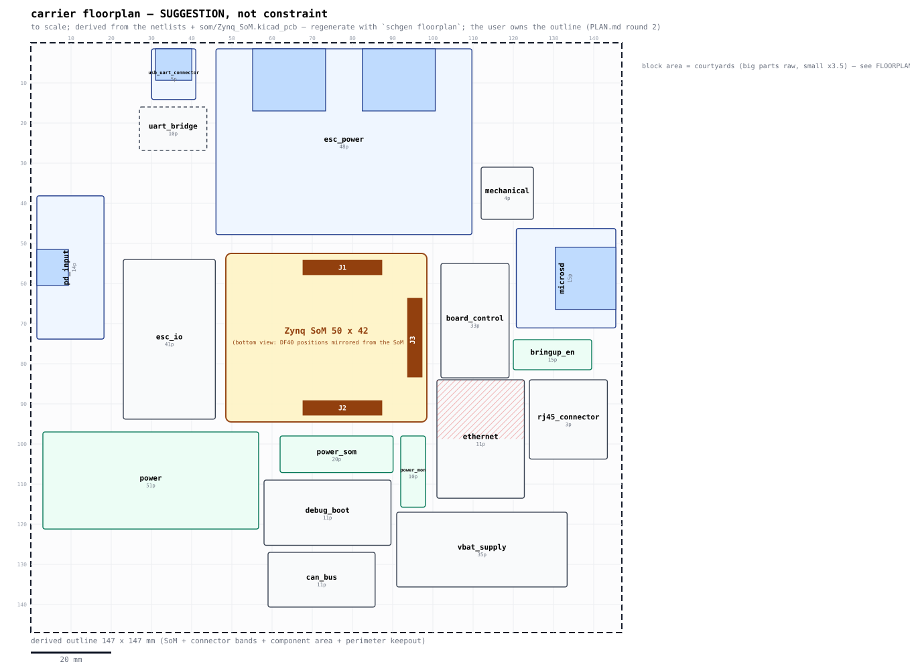

# Floorplan

## Sources (everything derived, nothing invented)

- SoM outline + connector positions: `som/Zynq_SoM.kicad_pcb` (Edge.Cuts bbox + connector footprints, parsed live)
- block sizes: per-part courtyards (`parts/<MPN>/<MPN>.kicad_mod` F.CrtYd; KiCad-standard footprints from the dims in their names), big parts raw + small parts x3.5 routing factor
- edge pinning + zones: connector parts in each sheet netlist + linker module-connector bindings (incl. `expect=` deferrals)
- electrical notes: `native/src/constraints.cpp` (JLC06161H-3313), `native/src/power_checks.cpp` analysis, typed ports (1.8V SDIO)

## Extracted SoM geometry

SoM outline: **50 x 42 mm**.

| conn | SoM PCB `(at)` | carrier-top view (SoM-rel) | pad extent |
|---|---|---|---|
| J1 | (136.5, 94.5) rot 180 | (29, 3.5) | 19.8 x 3.78 mm |
| J2 | (136.5, 129.5) rot 180 | (29, 38.5) | 19.8 x 3.78 mm |
| J3 | (154.5, 112) rot 90 | (47, 21) | 3.78 x 19.8 mm |

Derived board: **147 x 147 mm**; SoM origin at **(48.5, 52.5)** (centered). All coordinates below are board-frame mm, origin top-left, +y down (KiCad convention).

Outline derivation: SoM 50x42 + 7mm halo + 11mm connector band/edge -> core 86x78; component area 4549mm2 / 0.6 fill -> area floor 111x101; + 3mm perimeter keepout -> 120x110 mm (rounded up to 5mm grid); then bounded search over aspects 1, 1.0909, 1.1, 1.2, 1.3, 1.4 -> 147x147 mm (the smallest feasible board FOUND by this bounded aspect/grid search and greedy packing order, not a global minimum; holding the REAL 2-sided packed blocks with the estimated cross-subsystem airwire 6625 mm; advisory airwire reference 7497 mm, not an acceptance constraint), SoM 50x42 centered.

## Edge connectors (pinned to edges by their mating direction)

| edge | sheet | block (x, y, w x h) | connector(s) | notes |
|---|---|---|---|---|
| N | usb_uart_connector | (30.0547, 1.5, 10.9881 x 12.6341) | TYPE-C-31-M-12 (USB-C receptacle) |  |
| N | esc_power | (46.0478, 1.5, 63.656 x 46.3) | XT60PW-M (XT60 ESC power inlet (horizontal)), XT60PW-M (XT60 ESC power inlet (horizontal)) |  |
| W | pd_input | (1.5, 38.1494, 16.6982 x 35.7012) | TYPE-C-31-M-12 (USB-C receptacle) |  |
| E | microsd | (120.758, 46.3052, 24.7417 x 24.7743) | TF-01A (microSD push-pull) |  |

## Interior blocks (zone = dominant SoM connector side, or the power cluster)

| sheet | anchor | block (x, y, w x h) | parts | est mm2 | notes |
|---|---|---|---|---|---|
| board_control | E | (102, 55, 16.95 x 28.52) | 33 | 483.4 |  |
| bringup_en | E | (120, 74, 19.5 x 7.5) | 15 | 146.2 |  |
| can_bus | S | (59, 127, 26.63 x 13.65) | 11 | 363.5 |  |
| debug_boot | N | (58, 109, 31.58 x 16.25) | 11 | 513.2 |  |
| esc_io | E | (23, 54, 22.89 x 39.8) | 41 | 911 |  |
| ethernet | N | (101, 84, 21.745 x 29.5176) | 11 | 641.9 |  |
| mechanical | E | (112, 31, 13 x 13) | 4 | 169 |  |
| power | E | (3, 97, 53.6604 x 24.1899) | 51 | 1298 |  |
| power_mon | E | (92, 98, 6.124 x 17.748) | 10 | 108.7 |  |
| power_som | E | (62, 98, 28.1 x 9.1) | 20 | 255.7 |  |
| rj45_connector | E | (124, 84, 19.4 x 19.76) | 3 | 383.3 |  |
| uart_bridge | @usb_uart_connector | (27, 16, 16.78 x 10.805) | 10 | 181.3 |  |
| vbat_supply | E | (91, 117, 42.39 x 18.642) | 35 | 790.2 |  |

## Routing constraint classes (JLC06161H-3313 — from native/src/constraints.cpp)

| class | nets | geometry (track/gap mm) | match budget |
|---|---|---|---|
| DP100_DIFF | 16 | 0.1148 / 0.2032 | intra-pair <= 1.27 mm; inter-pair <= 1.27 mm |
| DP90_USB | 6 | 0.1455 / 0.2032 | intra-pair <= 3.81 mm; inter-pair <= 3.81 mm |
| I2C | 2 | - | - |
| SD_1V8 | 6 | - | bus to CLK <= 2.5 mm (policy) |

Full per-net table: `carrier/manufacturing/layout_constraints.csv` (+ the `.kicad_dru` rules).

## Power and thermal (worst-case declared draws — powertree analysis)

| regulator | sheet | rail | I out (A) | est dissipation |
|---|---|---|---|---|
| SY6280AAC (U2) | board_control | +5V -> +5V_FAN | 0.200 | negligible |
| SY6280AAC (U3) | esc_io | +5V -> +5V_MOTOR_IO | 0.000 | negligible |
| TPS26631PWPR (U1) | pd_input | +VBUS_IN -> +VIN_PD | 0.000 | negligible |
| LM61460AANRJRR (U1) | power | +VIN_SYS -> +5V_REG | 0.628 | ~0.35 W |
| LM61460AANRJRR (U2) | power | +5V -> +3V3_REG | 0.360 | ~0.13 W |
| AP2112K-1.8 (U3) | power | +3V3 -> +1V8_REG | 0.006 | negligible |
| LM61460AANRJRR (U4) | power_som | +VIN_SYS -> +5V_SOM | 2.154 | ~1.11 W |
| TPS26631PWPR (U1) | vbat_supply | +VBAT_D -> +VBAT_SW | 0.003 | negligible |
| LM61460AANRJRR (U2) | vbat_supply | +VBAT_SW -> +VPRE | 0.007 | negligible |

Numbers are the power-tree gate's worst-case declared draws (`carrier/reports/power_tree.txt`); regulators above ~0.3 W want copper pours + stitching vias.
