# Assembly order — motor_carrier

Board 117.5 x 88.75 mm. 358 placed parts (163 top / 195 bottom); 5 fiducials are bare-copper marks, excluded from every phase and step.
Section A is the staged hand-assembly + bring-up order; section B is the PCBA process order. Every part appears in exactly one phase and exactly one step.

## A. Incremental bring-up order

| phase | section | parts | checkpoint |
|---|---|---|---|
| 1 | power_mon | 10 | — |
| 2 | power | 51 | verify +5V at TP11001; verify +3V3 at TP11002; verify +1V8 at TP11003 |
| 3 | power_som | 20 | verify +5V_SOM at TP13001 |
| 4 | SoM interface (som_decoupling, som_j1, som_j2, som_j3) | 21 | — |
| 5 | SoM module mate | 0 | boot/debug via debug_boot: J4001, J4002, SW4001, SW4002 |
| 6 | bringup_en | 15 | — |
| 7 | esc_power | 48 | verify +VBAT_D at TP21004; verify +VESC at TP6002; verify +VESC_F at TP6005; verify +VESC_IN at TP6001; verify +VESC_P at TP6007 |
| 8 | ethernet | 11 | — |
| 9 | microsd | 15 | verify +3V3 at TP11002 |
| 10 | pd_input | 14 | verify +VBUS_IN at TP10001; verify +VIN_PD at TP10002 |
| 11 | usb_uart_connector | 5 | — |
| 12 | board_control | 33 | verify +5V_FAN at TP1010 |
| 13 | can_bus | 11 | — |
| 14 | debug_boot | 11 | — |
| 15 | esc_io | 41 | verify +5V_MOTOR_IO at TP5001 |
| 16 | rj45_connector | 3 | — |
| 17 | uart_bridge | 10 | — |
| 18 | vbat_supply | 35 | verify +VBAT_SW at TP21001; verify +VPRE at TP21002 |
| 19 | mechanical hardware (mechanical) | 4 | — |

### Phase 1 — power_mon

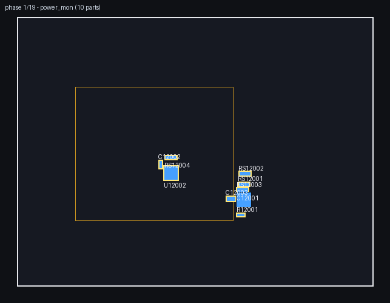

10 parts (1 top / 9 bottom)

| ref | value | package | sheet |
|---|---|---|---|
| C12001 | 100n | C_0603_1608Metric | power_mon |
| C12002 | 100n | C_0603_1608Metric | power_mon |
| C12003 | 10u | C_0805_2012Metric | power_mon |
| R12001 | 10k | R_0603_1608Metric | power_mon |
| RS12001 | 10mR | RLM12FTCMR010 | power_mon |
| RS12002 | 10mR | RLM12FTCMR010 | power_mon |
| RS12003 | 10mR | RLM12FTCMR010 | power_mon |
| RS12004 | 20mR | RLM12FTCMR020 | power_mon |
| U12001 | INA3221AIRGVR | INA3221AIRGVR | power_mon |
| U12002 | INA3221AIRGVR | INA3221AIRGVR | power_mon |

### Phase 2 — power

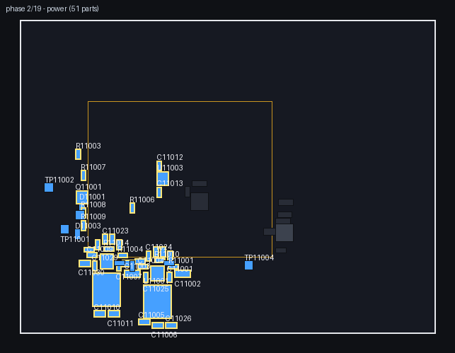

51 parts (9 top / 42 bottom)

| ref | value | package | sheet |
|---|---|---|---|
| C11001 | 100n | C_0603_1608Metric | power |
| C11002 | 10u | C_1206_3216Metric | power |
| C11003 | 10u | C_1206_3216Metric | power |
| C11004 | 100n | C_0603_1608Metric | power |
| C11005 | 22u | C_0805_2012Metric | power |
| C11006 | 22u | C_0805_2012Metric | power |
| C11007 | 100n | C_0603_1608Metric | power |
| C11008 | 22u | C_0805_2012Metric | power |
| C11009 | 100n | C_0603_1608Metric | power |
| C11010 | 22u | C_0805_2012Metric | power |
| C11011 | 22u | C_0805_2012Metric | power |
| C11012 | 1u | C_0603_1608Metric | power |
| C11013 | 1u | C_0603_1608Metric | power |
| C11023 | 22p | C_0603_1608Metric | power |
| C11024 | 1u | C_0603_1608Metric | power |
| C11025 | 100n | C_0603_1608Metric | power |
| C11026 | 22u | C_0805_2012Metric | power |
| C11027 | 22p | C_0603_1608Metric | power |
| C11028 | 1u | C_0603_1608Metric | power |
| C11029 | 100n | C_0603_1608Metric | power |
| C11030 | 22u | C_0805_2012Metric | power |
| C11031 | 1u | C_0603_1608Metric | power |
| C11032 | 1u | C_0603_1608Metric | power |
| D11001 | red | LED_0603_1608Metric | power |
| D11002 | red | LED_0603_1608Metric | power |
| D11003 | red | LED_0603_1608Metric | power |
| L11001 | 10uH | SWPA8040S100MT | power |
| L11002 | 10uH | SWPA8040S100MT | power |
| Q11001 | AO3400A | SOT-23 | power |
| R11001 | 40.2k | R_0603_1608Metric | power |
| R11002 | 10k | R_0603_1608Metric | power |
| R11003 | 1k | R_0603_1608Metric | power |
| R11004 | 23.2k | R_0603_1608Metric | power |
| R11005 | 10k | R_0603_1608Metric | power |
| R11006 | 330R | R_0603_1608Metric | power |
| R11007 | 1k | R_0603_1608Metric | power |
| R11008 | 100k | R_0603_1608Metric | power |
| R11009 | 330R | R_0603_1608Metric | power |
| R11010 | 22k | R_0603_1608Metric | power |
| R11011 | 10R | R_0603_1608Metric | power |
| R11012 | 1k | R_0603_1608Metric | power |
| R11013 | 10R | R_0603_1608Metric | power |
| R11014 | 22k | R_0603_1608Metric | power |
| R11015 | 1k | R_0603_1608Metric | power |
| TP11001 | +5V | TestPoint_Pad_D1.5mm | power |
| TP11002 | +3V3 | TestPoint_Pad_D1.5mm | power |
| TP11003 | +1V8 | TestPoint_Pad_D1.5mm | power |
| TP11004 | GND | TestPoint_Pad_D1.5mm | power |
| U11001 | LM61460AANRJRR | LM61460AANRJRR | power |
| U11002 | LM61460AANRJRR | LM61460AANRJRR | power |
| U11003 | AP2112K-1.8 | SOT-23-5 | power |

CHECKPOINT: verify +5V at TP11001
CHECKPOINT: verify +3V3 at TP11002
CHECKPOINT: verify +1V8 at TP11003

### Phase 3 — power_som

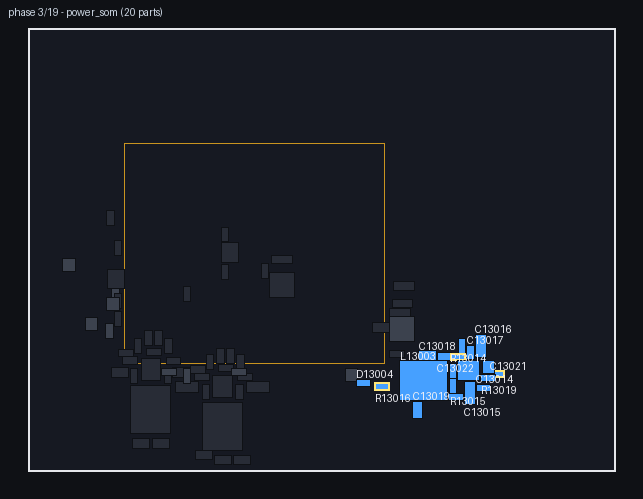

20 parts (17 top / 3 bottom)

| ref | value | package | sheet |
|---|---|---|---|
| C13014 | 100n | C_0603_1608Metric | power_som |
| C13015 | 10u | C_1206_3216Metric | power_som |
| C13016 | 10u | C_1206_3216Metric | power_som |
| C13017 | 100n | C_0603_1608Metric | power_som |
| C13018 | 22u | C_0805_2012Metric | power_som |
| C13019 | 22u | C_0805_2012Metric | power_som |
| C13021 | 22p | C_0603_1608Metric | power_som |
| C13022 | 1u | C_0603_1608Metric | power_som |
| C13023 | 1u | C_0603_1608Metric | power_som |
| C13025 | 100n | C_0603_1608Metric | power_som |
| D13004 | red | LED_0603_1608Metric | power_som |
| L13003 | 10uH | SWPA8040S100MT | power_som |
| R13014 | 47.5k | R_0603_1608Metric | power_som |
| R13015 | 13k | R_0603_1608Metric | power_som |
| R13016 | 1k | R_0603_1608Metric | power_som |
| R13017 | 10R | R_0603_1608Metric | power_som |
| R13018 | 22k | R_0603_1608Metric | power_som |
| R13019 | 1k | R_0603_1608Metric | power_som |
| TP13001 | +5V_SOM | TestPoint_Pad_D1.5mm | power_som |
| U13004 | LM61460AANRJRR | LM61460AANRJRR | power_som |

CHECKPOINT: verify +5V_SOM at TP13001

### Phase 4 — SoM interface (som_decoupling, som_j1, som_j2, som_j3)

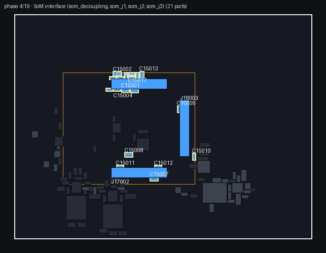

21 parts (3 top / 18 bottom)

| ref | value | package | sheet |
|---|---|---|---|
| C15001 | 22u | C_0805_2012Metric | som_decoupling |
| C15002 | 22u | C_0805_2012Metric | som_decoupling |
| C15003 | 100n | C_0603_1608Metric | som_decoupling |
| C15004 | 100n | C_0603_1608Metric | som_decoupling |
| C15005 | 100n | C_0603_1608Metric | som_decoupling |
| C15006 | 100n | C_0603_1608Metric | som_decoupling |
| C15007 | 22u | C_0805_2012Metric | som_decoupling |
| C15008 | 22u | C_0805_2012Metric | som_decoupling |
| C15009 | 100n | C_0603_1608Metric | som_decoupling |
| C15010 | 100n | C_0603_1608Metric | som_decoupling |
| C15011 | 100n | C_0603_1608Metric | som_decoupling |
| C15012 | 100n | C_0603_1608Metric | som_decoupling |
| C15013 | 22u | C_0805_2012Metric | som_decoupling |
| C15014 | 22u | C_0805_2012Metric | som_decoupling |
| C15015 | 100n | C_0603_1608Metric | som_decoupling |
| C15016 | 100n | C_0603_1608Metric | som_decoupling |
| C15017 | 100n | C_0603_1608Metric | som_decoupling |
| C15018 | 100n | C_0603_1608Metric | som_decoupling |
| J16001 | DF40C-100DP-0.4V(51) | HRS_DF40C-100DP-0.4V_51_ | som_j1 |
| J17002 | DF40C-100DP-0.4V(51) | HRS_DF40C-100DP-0.4V_51_ | som_j2 |
| J18003 | DF40C-100DP-0.4V(51) | HRS_DF40C-100DP-0.4V_51_ | som_j3 |

### Phase 5 — SoM module mate

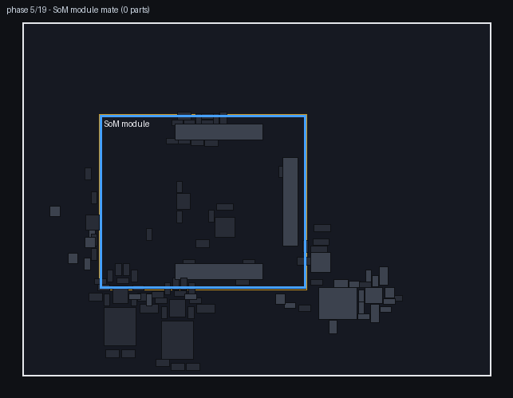

No solder parts. Mate the SoM module onto J16001, J17002, J18003 after the rail checkpoints above.

CHECKPOINT: boot/debug via debug_boot: J4001, J4002, SW4001, SW4002

### Phase 6 — bringup_en

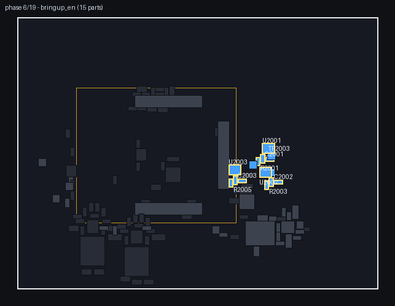

15 parts (3 top / 12 bottom)

| ref | value | package | sheet |
|---|---|---|---|
| C2001 | 100n | C_0603_1608Metric | bringup_en |
| C2002 | 100n | C_0603_1608Metric | bringup_en |
| C2003 | 100n | C_0603_1608Metric | bringup_en |
| R2001 | 100k | R_0603_1608Metric | bringup_en |
| R2002 | 100k | R_0603_1608Metric | bringup_en |
| R2003 | 100k | R_0603_1608Metric | bringup_en |
| R2004 | 100k | R_0603_1608Metric | bringup_en |
| R2005 | 100k | R_0603_1608Metric | bringup_en |
| R2006 | 100k | R_0603_1608Metric | bringup_en |
| TP2001 | EN_5V0 | TestPoint_Pad_D1.5mm | bringup_en |
| TP2002 | EN_3V3 | TestPoint_Pad_D1.5mm | bringup_en |
| TP2003 | EN_1V8 | TestPoint_Pad_D1.5mm | bringup_en |
| U2001 | SN74LVC1G08 | SOT-23-5 | bringup_en |
| U2002 | SN74LVC1G08 | SOT-23-5 | bringup_en |
| U2003 | SN74LVC1G08 | SOT-23-5 | bringup_en |

### Phase 7 — esc_power

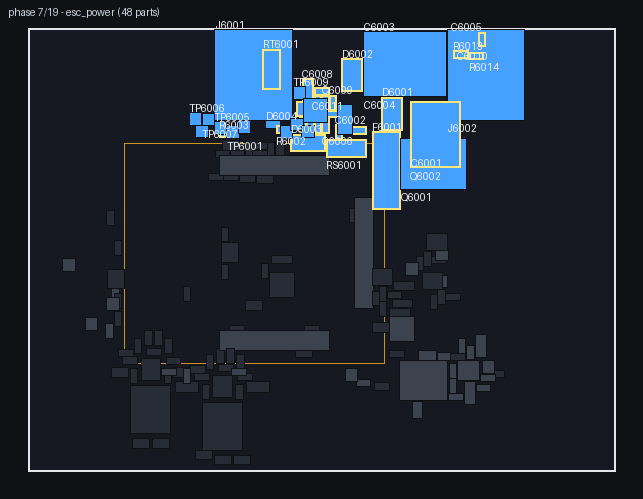

48 parts (17 top / 31 bottom)

| ref | value | package | sheet |
|---|---|---|---|
| C6001 | 100n/100V | C_0603_1608Metric | esc_power |
| C6002 | 100n | C_0603_1608Metric | esc_power |
| C6003 | 470u | RVT1H471M1213 | esc_power |
| C6004 | 470u | RVT1H471M1213 | esc_power |
| C6005 | 100n/100V | C_0603_1608Metric | esc_power |
| C6006 | 100n/100V | C_0603_1608Metric | esc_power |
| C6007 | 1u | C_0603_1608Metric | esc_power |
| C6008 | 1u/100V | C_1206_3216Metric | esc_power |
| C6009 | 1u | C_0603_1608Metric | esc_power |
| C6010 | 100n | C_0603_1608Metric | esc_power |
| C6011 | 100n/100V | C_0603_1608Metric | esc_power |
| D6001 | SMBJ28A | SMBJ28A | esc_power |
| D6002 | SMBJ28A | SMBJ28A | esc_power |
| D6003 | SS54 | D_SMA | esc_power |
| D6004 | red | LED_0603_1608Metric | esc_power |
| F6001 | 40A | 0456040.DR | esc_power |
| J6001 | XT60PW-M | XT60PW-M | esc_power |
| J6002 | XT60PW-M | XT60PW-M | esc_power |
| Q6001 | IPT007N06N | IPT007N06N | esc_power |
| Q6002 | IPT007N06N | IPT007N06N | esc_power |
| R6001 | 10k | R_0603_1608Metric | esc_power |
| R6002 | 5.1k | R_0603_1608Metric | esc_power |
| R6003 | 5.1k | R_0603_1608Metric | esc_power |
| R6004 | 100R | R_0603_1608Metric | esc_power |
| R6005 | 49.9R | R_0603_1608Metric | esc_power |
| R6006 | 4k7 | R_0603_1608Metric | esc_power |
| R6007 | 15k | R_0603_1608Metric | esc_power |
| R6008 | 4k7 | R_0603_1608Metric | esc_power |
| R6009 | 10k | R_0603_1608Metric | esc_power |
| R6010 | 10k | R_0603_1608Metric | esc_power |
| R6011 | 100k | R_0603_1608Metric | esc_power |
| R6012 | 100k | R_0603_1608Metric | esc_power |
| R6013 | 10k | R_0603_1608Metric | esc_power |
| R6014 | 10k | R_0603_1608Metric | esc_power |
| RS6001 | 0.5mR | RLM25FEGMR50M | esc_power |
| RT6001 | 0.5mR | RLM25FEGMR50M | esc_power |
| TP6001 | +VESC_IN | TestPoint_Pad_D1.5mm | esc_power |
| TP6002 | +VESC | TestPoint_Pad_D1.5mm | esc_power |
| TP6003 | GND_MOTOR | TestPoint_Pad_D1.5mm | esc_power |
| TP6004 | GND | TestPoint_Pad_D1.5mm | esc_power |
| TP6005 | +VESC_F | TestPoint_Pad_D1.5mm | esc_power |
| TP6006 | +VESC_MID | TestPoint_Pad_D1.5mm | esc_power |
| TP6007 | +VESC_P | TestPoint_Pad_D1.5mm | esc_power |
| TP6008 | ESC_PWR_EN | TestPoint_Pad_D1.5mm | esc_power |
| TP6009 | PROT_IMON | TestPoint_Pad_D1.5mm | esc_power |
| TP6010 | VSENSE_DIV | TestPoint_Pad_D1.5mm | esc_power |
| U6001 | INA237AIDGSR | INA237AIDGSR | esc_power |
| U6002 | LM74930QRGERQ1 | LM74930QRGERQ1 | esc_power |

CHECKPOINT: verify +VBAT_D at TP21004
CHECKPOINT: verify +VESC at TP6002
CHECKPOINT: verify +VESC_F at TP6005
CHECKPOINT: verify +VESC_IN at TP6001
CHECKPOINT: verify +VESC_P at TP6007

### Phase 8 — ethernet

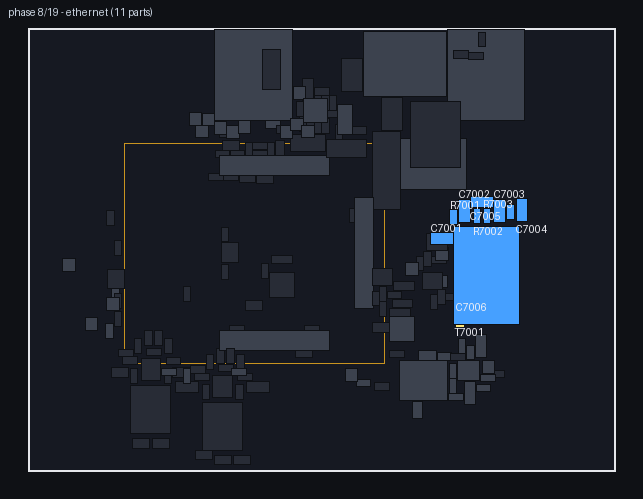

11 parts (10 top / 1 bottom)

| ref | value | package | sheet |
|---|---|---|---|
| C7001 | 1n | C_1206_3225Metric | ethernet |
| C7002 | 1n | C_1206_3225Metric | ethernet |
| C7003 | 1n | C_1206_3225Metric | ethernet |
| C7004 | 1n | C_1206_3225Metric | ethernet |
| C7005 | 1n | C_1206_3225Metric | ethernet |
| C7006 | 100n | C_0603_1608Metric | ethernet |
| R7001 | 75R | R_0603_1608Metric | ethernet |
| R7002 | 75R | R_0603_1608Metric | ethernet |
| R7003 | 75R | R_0603_1608Metric | ethernet |
| R7004 | 75R | R_0603_1608Metric | ethernet |
| T7001 | HX5008NLT | HX5008NLT | ethernet |

### Phase 9 — microsd

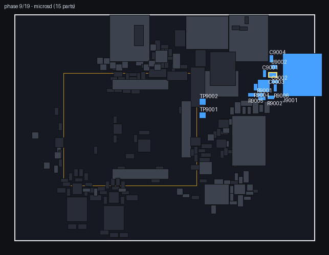

15 parts (14 top / 1 bottom)

| ref | value | package | sheet |
|---|---|---|---|
| C9001 | 100n | C_0603_1608Metric | microsd |
| C9002 | 100n | C_0603_1608Metric | microsd |
| C9003 | 22u | C_0805_2012Metric | microsd |
| C9004 | 100n | C_0603_1608Metric | microsd |
| J9001 | TF-01A | TF-01A | microsd |
| R9001 | 100k | R_0603_1608Metric | microsd |
| R9002 | 100k | R_0603_1608Metric | microsd |
| R9003 | 100k | R_0603_1608Metric | microsd |
| R9004 | 100k | R_0603_1608Metric | microsd |
| R9005 | 100k | R_0603_1608Metric | microsd |
| R9006 | 10k | R_0603_1608Metric | microsd |
| TP9001 | SDIO_CMD | TestPoint_Pad_D1.5mm | microsd |
| TP9002 | SDIO_CLK | TestPoint_Pad_D1.5mm | microsd |
| U9001 | TXS02612RTWR | TXS02612RTWR | microsd |
| U9002 | TPD6E001RSER | TPD6E001RSER | microsd |

CHECKPOINT: verify +3V3 at TP11002

### Phase 10 — pd_input

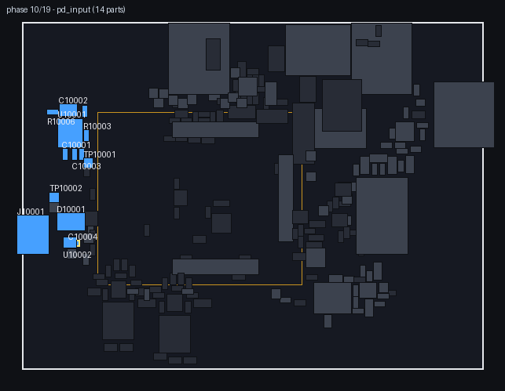

14 parts (13 top / 1 bottom)

| ref | value | package | sheet |
|---|---|---|---|
| C10001 | 100n | C_0603_1608Metric | pd_input |
| C10002 | 10u | C_1210_3225Metric | pd_input |
| C10003 | 47n | C_0603_1608Metric | pd_input |
| C10004 | 100n | C_0603_1608Metric | pd_input |
| D10001 | SMBJ22A | D_SMB | pd_input |
| J10001 | TYPE-C-31-M-12 | TYPE-C-31-M-12 | pd_input |
| R10003 | 100k | R_0603_1608Metric | pd_input |
| R10004 | 5.49k | R_0603_1608Metric | pd_input |
| R10005 | 5.1k | R_0603_1608Metric | pd_input |
| R10006 | 100k | R_0603_1608Metric | pd_input |
| TP10001 | +VBUS_IN | TestPoint_Pad_D1.5mm | pd_input |
| TP10002 | +VIN_PD | TestPoint_Pad_D1.5mm | pd_input |
| U10001 | TPS26631PWPR | TPS26631PWPR | pd_input |
| U10002 | USBLC6-2SC6 | USBLC6-2SC6 | pd_input |

CHECKPOINT: verify +VBUS_IN at TP10001
CHECKPOINT: verify +VIN_PD at TP10002

### Phase 11 — usb_uart_connector

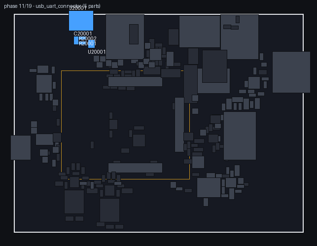

5 parts (5 top / 0 bottom)

| ref | value | package | sheet |
|---|---|---|---|
| C20001 | 10u | C_0805_2012Metric | usb_uart_connector |
| J20001 | TYPE-C-31-M-12 | TYPE-C-31-M-12 | usb_uart_connector |
| R20001 | 5.1k | R_0603_1608Metric | usb_uart_connector |
| R20002 | 5.1k | R_0603_1608Metric | usb_uart_connector |
| U20001 | USBLC6-2SC6 | USBLC6-2SC6 | usb_uart_connector |

### Phase 12 — board_control

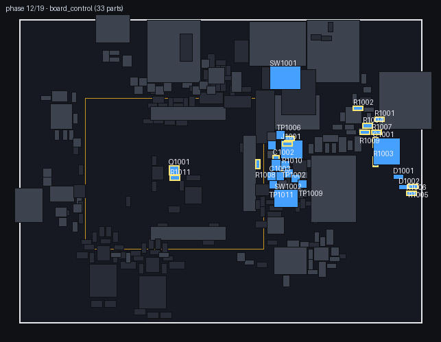

33 parts (16 top / 17 bottom)

| ref | value | package | sheet |
|---|---|---|---|
| C1001 | 100n | C_0603_1608Metric | board_control |
| C1002 | 10u | C_0805_2012Metric | board_control |
| C1003 | 10u | C_0805_2012Metric | board_control |
| D1001 | green | LED_0603_1608Metric | board_control |
| D1002 | red | LED_0603_1608Metric | board_control |
| J1001 | ZX-SH1.0-4PWT | ZX-SH1.0-4PWT | board_control |
| Q1001 | AO3400A | AO3400A | board_control |
| R1001 | 4k7 | R_0603_1608Metric | board_control |
| R1002 | 4k7 | R_0603_1608Metric | board_control |
| R1003 | 10k | R_0603_1608Metric | board_control |
| R1004 | 100k | R_0603_1608Metric | board_control |
| R1005 | 1k | R_0603_1608Metric | board_control |
| R1006 | 1k | R_0603_1608Metric | board_control |
| R1007 | 10k | R_0603_1608Metric | board_control |
| R1008 | 1k | R_0603_1608Metric | board_control |
| R1009 | 100k | R_0603_1608Metric | board_control |
| R1010 | 13k | R_0603_1608Metric | board_control |
| R1011 | 100k | R_0603_1608Metric | board_control |
| R1012 | 10k | R_0603_1608Metric | board_control |
| R1013 | 1k | R_0603_1608Metric | board_control |
| SW1001 | DIP-4 | DSHP04TSGER | board_control |
| SW1002 | USER | TS-1187A-B-A-B | board_control |
| TP1001 | XP16 | TestPoint_Pad_D1.5mm | board_control |
| TP1002 | XP17 | TestPoint_Pad_D1.5mm | board_control |
| TP1005 | STM32_I2C2_SCL | TestPoint_Pad_D1.5mm | board_control |
| TP1006 | STM32_I2C2_SDA | TestPoint_Pad_D1.5mm | board_control |
| TP1007 | +3V3_SC | TestPoint_Pad_D1.5mm | board_control |
| TP1008 | SC_INT_N | TestPoint_Pad_D1.5mm | board_control |
| TP1009 | PUDC_34 | TestPoint_Pad_D1.5mm | board_control |
| TP1010 | +5V_FAN | TestPoint_Pad_D1.5mm | board_control |
| TP1011 | ESC_PWR_REQ | TestPoint_Pad_D1.5mm | board_control |
| U1001 | TCA9535PWR | TCA9535PWR | board_control |
| U1002 | SY6280AAC | SY6280AAC | board_control |

CHECKPOINT: verify +5V_FAN at TP1010

### Phase 13 — can_bus

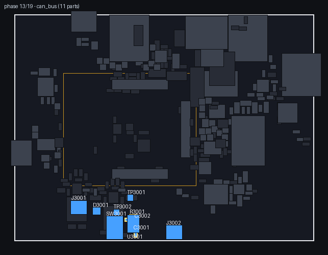

11 parts (7 top / 4 bottom)

| ref | value | package | sheet |
|---|---|---|---|
| C3001 | 100n | C_0603_1608Metric | can_bus |
| C3002 | 100n | C_0603_1608Metric | can_bus |
| D3001 | NUP2105LT1G | NUP2105LT1G | can_bus |
| J3001 | ZX-SH1.0-4PWT | ZX-SH1.0-4PWT | can_bus |
| J3002 | ZX-SH1.0-4PWT | ZX-SH1.0-4PWT | can_bus |
| R3001 | 10k | R_0603_1608Metric | can_bus |
| R3002 | 120R | R_0603_1608Metric | can_bus |
| SW3001 | DIP-4 | DSHP04TSGER | can_bus |
| TP3001 | CAN_H | TestPoint_Pad_D1.5mm | can_bus |
| TP3002 | CAN_L | TestPoint_Pad_D1.5mm | can_bus |
| U3001 | TCAN1042HGVDR | TCAN1042HGVDR | can_bus |

### Phase 14 — debug_boot

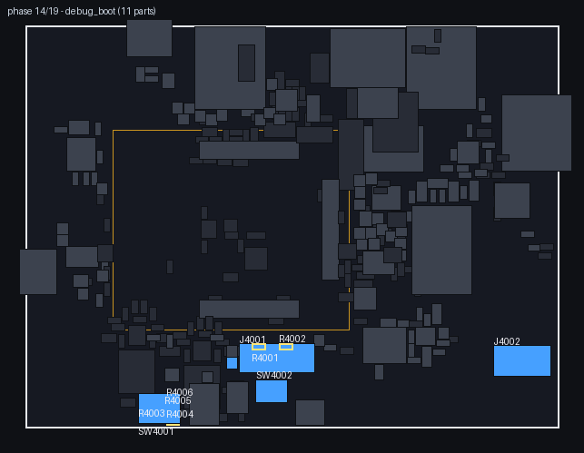

11 parts (5 top / 6 bottom)

| ref | value | package | sheet |
|---|---|---|---|
| J4001 | 878311420 | 878311420 | debug_boot |
| J4002 | HX_JN1.27-2x5 | HX_JN1.27-2x5_TP_H4.9 | debug_boot |
| R4001 | 4k7 | R_0603_1608Metric | debug_boot |
| R4002 | 4k7 | R_0603_1608Metric | debug_boot |
| R4003 | 100R | R_0603_1608Metric | debug_boot |
| R4004 | 10k | R_0603_1608Metric | debug_boot |
| R4005 | 10k | R_0603_1608Metric | debug_boot |
| R4006 | 10k | R_0603_1608Metric | debug_boot |
| SW4001 | DIP-4 | DSHP04TSGER | debug_boot |
| SW4002 | RESET | TS-1187A-B-A-B | debug_boot |
| TP4001 | VBUS_OUT_EN | TestPoint_Pad_D1.5mm | debug_boot |

### Phase 15 — esc_io

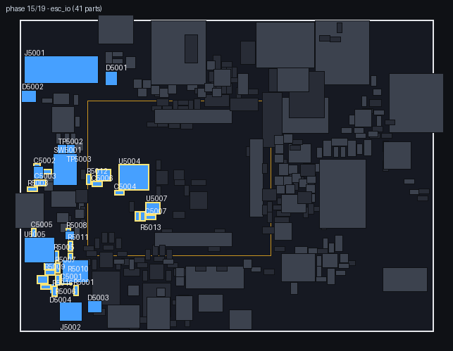

41 parts (13 top / 28 bottom)

| ref | value | package | sheet |
|---|---|---|---|
| C5001 | 100n | C_0603_1608Metric | esc_io |
| C5002 | 10u | C_0805_2012Metric | esc_io |
| C5003 | 10u | C_0805_2012Metric | esc_io |
| C5004 | 100n | C_0603_1608Metric | esc_io |
| C5005 | 100n | C_0603_1608Metric | esc_io |
| C5006 | 100n | C_0603_1608Metric | esc_io |
| C5007 | 100n | C_0603_1608Metric | esc_io |
| D5001 | SRV05-4 | SOT-23-6 | esc_io |
| D5002 | SRV05-4 | SOT-23-6 | esc_io |
| D5003 | SRV05-4 | SOT-23-6 | esc_io |
| D5004 | blue | LED_0603_1608Metric | esc_io |
| J5001 | HX PZ2.54-3x8P ZZ | HX_PZ2.54-3x8P_ZZ | esc_io |
| J5002 | ZX-SH1.0-4PWT | ZX-SH1.0-4PWT | esc_io |
| R5001 | 10k | R_0603_1608Metric | esc_io |
| R5002 | 13k | R_0603_1608Metric | esc_io |
| R5003 | 100k | R_0603_1608Metric | esc_io |
| R5004 | 10k | R_0603_1608Metric | esc_io |
| R5005 | 10k | R_0603_1608Metric | esc_io |
| R5006 | 10k | R_0603_1608Metric | esc_io |
| R5007 | 10k | R_0603_1608Metric | esc_io |
| R5008 | 10k | R_0603_1608Metric | esc_io |
| R5009 | 10k | R_0603_1608Metric | esc_io |
| R5010 | 10k | R_0603_1608Metric | esc_io |
| R5011 | 10k | R_0603_1608Metric | esc_io |
| R5012 | 100k | R_0603_1608Metric | esc_io |
| R5013 | 1k | R_0603_1608Metric | esc_io |
| R5014 | 10k | R_0603_1608Metric | esc_io |
| R5015 | 10k | R_0603_1608Metric | esc_io |
| R5016 | 1k | R_0603_1608Metric | esc_io |
| RN5001 | 4D03WGJ0330T5E | 4D03WGJ0330T5E | esc_io |
| RN5002 | 4D03WGJ0330T5E | 4D03WGJ0330T5E | esc_io |
| SW5001 | DIP-4 | DSHP04TSGER | esc_io |
| TP5001 | +5V_MOTOR_IO | TestPoint_Pad_D1.5mm | esc_io |
| TP5002 | ESC_BIAS | TestPoint_Pad_D1.5mm | esc_io |
| TP5003 | OE_BUF_N | TestPoint_Pad_D1.5mm | esc_io |
| U5001 | SN74HCT245PWR | SN74HCT245PWR | esc_io |
| U5003 | SY6280AAC | SY6280AAC | esc_io |
| U5004 | SN74LVC125ADR | SN74LVC125ADR | esc_io |
| U5005 | SN74LVC125ADR | SN74LVC125ADR | esc_io |
| U5006 | SN74LVC1G08 | SOT-23-5 | esc_io |
| U5007 | SN74LVC1G08 | SOT-23-5 | esc_io |

CHECKPOINT: verify +5V_MOTOR_IO at TP5001

### Phase 16 — rj45_connector

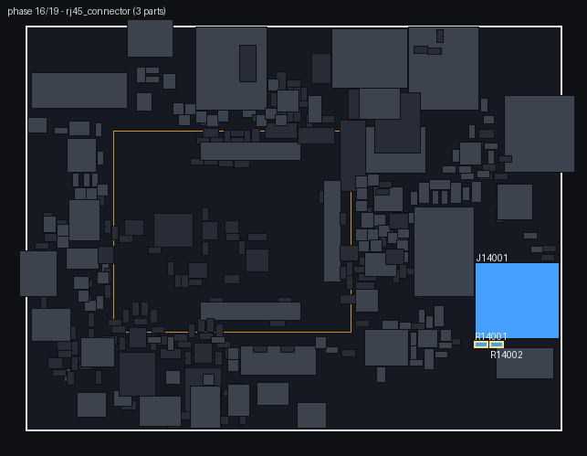

3 parts (1 top / 2 bottom)

| ref | value | package | sheet |
|---|---|---|---|
| J14001 | KH-5224-8P8C-D | KH-5224-8P8C-D | rj45_connector |
| R14001 | 330R | R_0603_1608Metric | rj45_connector |
| R14002 | 330R | R_0603_1608Metric | rj45_connector |

### Phase 17 — uart_bridge

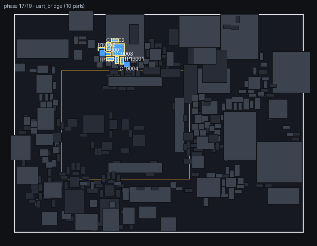

10 parts (2 top / 8 bottom)

| ref | value | package | sheet |
|---|---|---|---|
| C19001 | 100n | C_0603_1608Metric | uart_bridge |
| C19002 | 10u | C_0805_2012Metric | uart_bridge |
| C19003 | 100n | C_0603_1608Metric | uart_bridge |
| C19004 | 100n | C_0603_1608Metric | uart_bridge |
| R19001 | 1k | R_0603_1608Metric | uart_bridge |
| R19002 | 22k1 | R_0603_1608Metric | uart_bridge |
| R19003 | 47k5 | R_0603_1608Metric | uart_bridge |
| TP19001 | ZYNQ_PS_UART0_TXD | TestPoint_Pad_D1.5mm | uart_bridge |
| TP19002 | ZYNQ_PS_UART0_RXD | TestPoint_Pad_D1.5mm | uart_bridge |
| U19001 | CP2102N-A02 | CP2102N-A02-GQFN24R | uart_bridge |

### Phase 18 — vbat_supply

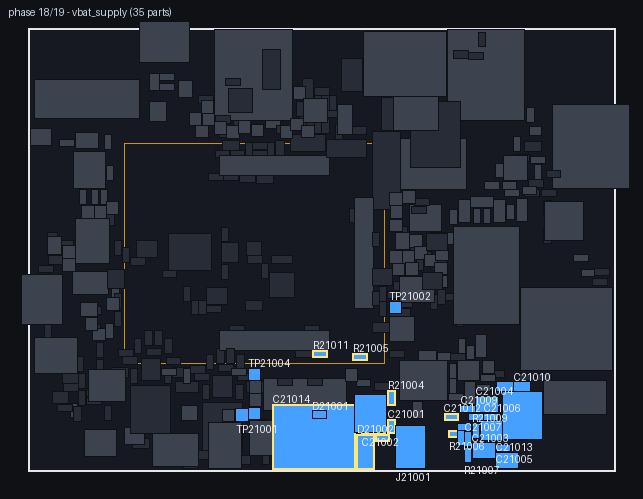

35 parts (23 top / 12 bottom)

| ref | value | package | sheet |
|---|---|---|---|
| C21001 | 47n | C_0603_1608Metric | vbat_supply |
| C21002 | 100n/100V | C_0603_1608Metric | vbat_supply |
| C21003 | 4u7/100V | C_1210_3225Metric | vbat_supply |
| C21004 | 4u7/100V | C_1210_3225Metric | vbat_supply |
| C21005 | 100n/100V | C_0603_1608Metric | vbat_supply |
| C21006 | 100n/100V | C_0603_1608Metric | vbat_supply |
| C21007 | 1u | C_0603_1608Metric | vbat_supply |
| C21008 | 1u | C_0603_1608Metric | vbat_supply |
| C21009 | 100n | C_0603_1608Metric | vbat_supply |
| C21010 | 22u | C_0805_2012Metric | vbat_supply |
| C21011 | 22u | C_0805_2012Metric | vbat_supply |
| C21012 | 22p | C_0603_1608Metric | vbat_supply |
| C21013 | 4u7/100V | C_1210_3225Metric | vbat_supply |
| C21014 | 470u | RVT1H471M1213 | vbat_supply |
| D21001 | red | LED_0603_1608Metric | vbat_supply |
| D21002 | SS54 | D_SMA | vbat_supply |
| J21001 | A2541WV-2x3P | PinHeader_2x03_P2.54mm_Vertical | vbat_supply |
| L21001 | 10uH | SWPA8040S100MT | vbat_supply |
| R21001 | 100k | R_0603_1608Metric | vbat_supply |
| R21002 | 10k | R_0603_1608Metric | vbat_supply |
| R21003 | 5.1k | R_0603_1608Metric | vbat_supply |
| R21004 | 5.49k | R_0603_1608Metric | vbat_supply |
| R21005 | 100k | R_0603_1608Metric | vbat_supply |
| R21006 | 10R | R_0603_1608Metric | vbat_supply |
| R21007 | 22k | R_0603_1608Metric | vbat_supply |
| R21008 | 47.5k | R_0603_1608Metric | vbat_supply |
| R21009 | 6.8k | R_0603_1608Metric | vbat_supply |
| R21010 | 1k | R_0603_1608Metric | vbat_supply |
| R21011 | 1k | R_0603_1608Metric | vbat_supply |
| TP21001 | +VBAT_SW | TestPoint_Pad_D1.5mm | vbat_supply |
| TP21002 | +VPRE | TestPoint_Pad_D1.5mm | vbat_supply |
| TP21003 | +VIN | TestPoint_Pad_D1.5mm | vbat_supply |
| TP21004 | +VBAT_D | TestPoint_Pad_D1.5mm | vbat_supply |
| U21001 | TPS26631PWPR | TPS26631PWPR | vbat_supply |
| U21002 | LM61460AANRJRR | LM61460AANRJRR | vbat_supply |

CHECKPOINT: verify +VBAT_SW at TP21001
CHECKPOINT: verify +VPRE at TP21002

### Phase 19 — mechanical hardware (mechanical)

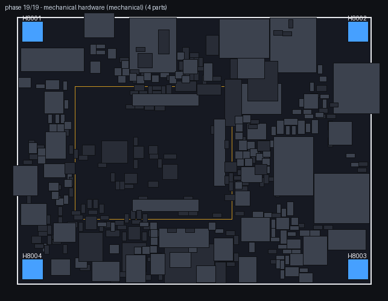

4 parts (4 top / 0 bottom)

| ref | value | package | sheet |
|---|---|---|---|
| H8001 | MountingHole_M3 | MountingHole_3.2mm_M3_Pad | mechanical |
| H8002 | MountingHole_M3 | MountingHole_3.2mm_M3_Pad | mechanical |
| H8003 | MountingHole_M3 | MountingHole_3.2mm_M3_Pad | mechanical |
| H8004 | MountingHole_M3 | MountingHole_3.2mm_M3_Pad | mechanical |

## B. Production process order

### Step 1 — Bottom-side SMD (paste + reflow)

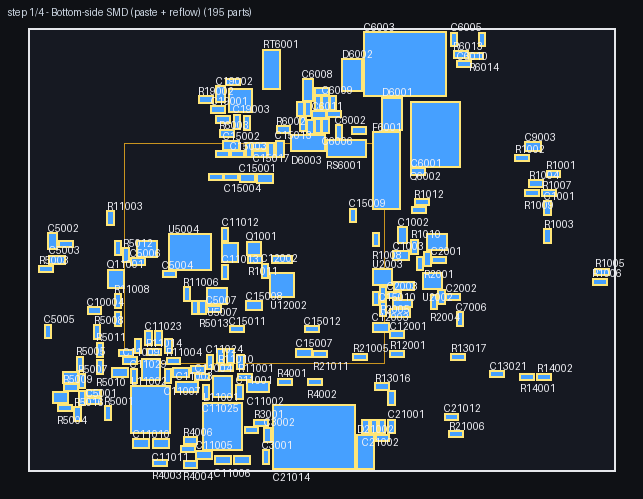

195 parts (0 top / 195 bottom)

| ref | value | package | sheet |
|---|---|---|---|
| C1001 | 100n | C_0603_1608Metric | board_control |
| C1002 | 10u | C_0805_2012Metric | board_control |
| C1003 | 10u | C_0805_2012Metric | board_control |
| C2001 | 100n | C_0603_1608Metric | bringup_en |
| C2002 | 100n | C_0603_1608Metric | bringup_en |
| C2003 | 100n | C_0603_1608Metric | bringup_en |
| C3001 | 100n | C_0603_1608Metric | can_bus |
| C3002 | 100n | C_0603_1608Metric | can_bus |
| C5001 | 100n | C_0603_1608Metric | esc_io |
| C5002 | 10u | C_0805_2012Metric | esc_io |
| C5003 | 10u | C_0805_2012Metric | esc_io |
| C5004 | 100n | C_0603_1608Metric | esc_io |
| C5005 | 100n | C_0603_1608Metric | esc_io |
| C5006 | 100n | C_0603_1608Metric | esc_io |
| C5007 | 100n | C_0603_1608Metric | esc_io |
| C6001 | 100n/100V | C_0603_1608Metric | esc_power |
| C6002 | 100n | C_0603_1608Metric | esc_power |
| C6003 | 470u | RVT1H471M1213 | esc_power |
| C6005 | 100n/100V | C_0603_1608Metric | esc_power |
| C6006 | 100n/100V | C_0603_1608Metric | esc_power |
| C6007 | 1u | C_0603_1608Metric | esc_power |
| C6008 | 1u/100V | C_1206_3216Metric | esc_power |
| C6009 | 1u | C_0603_1608Metric | esc_power |
| C6010 | 100n | C_0603_1608Metric | esc_power |
| C6011 | 100n/100V | C_0603_1608Metric | esc_power |
| C7006 | 100n | C_0603_1608Metric | ethernet |
| C9003 | 22u | C_0805_2012Metric | microsd |
| C10004 | 100n | C_0603_1608Metric | pd_input |
| C11001 | 100n | C_0603_1608Metric | power |
| C11002 | 10u | C_1206_3216Metric | power |
| C11003 | 10u | C_1206_3216Metric | power |
| C11004 | 100n | C_0603_1608Metric | power |
| C11005 | 22u | C_0805_2012Metric | power |
| C11006 | 22u | C_0805_2012Metric | power |
| C11007 | 100n | C_0603_1608Metric | power |
| C11008 | 22u | C_0805_2012Metric | power |
| C11009 | 100n | C_0603_1608Metric | power |
| C11010 | 22u | C_0805_2012Metric | power |
| C11011 | 22u | C_0805_2012Metric | power |
| C11012 | 1u | C_0603_1608Metric | power |
| C11013 | 1u | C_0603_1608Metric | power |
| C11023 | 22p | C_0603_1608Metric | power |
| C11024 | 1u | C_0603_1608Metric | power |
| C11025 | 100n | C_0603_1608Metric | power |
| C11026 | 22u | C_0805_2012Metric | power |
| C11027 | 22p | C_0603_1608Metric | power |
| C11028 | 1u | C_0603_1608Metric | power |
| C11029 | 100n | C_0603_1608Metric | power |
| C11030 | 22u | C_0805_2012Metric | power |
| C11031 | 1u | C_0603_1608Metric | power |
| C11032 | 1u | C_0603_1608Metric | power |
| C12001 | 100n | C_0603_1608Metric | power_mon |
| C12002 | 100n | C_0603_1608Metric | power_mon |
| C12003 | 10u | C_0805_2012Metric | power_mon |
| C13021 | 22p | C_0603_1608Metric | power_som |
| C15001 | 22u | C_0805_2012Metric | som_decoupling |
| C15002 | 22u | C_0805_2012Metric | som_decoupling |
| C15003 | 100n | C_0603_1608Metric | som_decoupling |
| C15004 | 100n | C_0603_1608Metric | som_decoupling |
| C15005 | 100n | C_0603_1608Metric | som_decoupling |
| C15006 | 100n | C_0603_1608Metric | som_decoupling |
| C15007 | 22u | C_0805_2012Metric | som_decoupling |
| C15008 | 22u | C_0805_2012Metric | som_decoupling |
| C15009 | 100n | C_0603_1608Metric | som_decoupling |
| C15010 | 100n | C_0603_1608Metric | som_decoupling |
| C15011 | 100n | C_0603_1608Metric | som_decoupling |
| C15012 | 100n | C_0603_1608Metric | som_decoupling |
| C15013 | 22u | C_0805_2012Metric | som_decoupling |
| C15014 | 22u | C_0805_2012Metric | som_decoupling |
| C15015 | 100n | C_0603_1608Metric | som_decoupling |
| C15016 | 100n | C_0603_1608Metric | som_decoupling |
| C15017 | 100n | C_0603_1608Metric | som_decoupling |
| C15018 | 100n | C_0603_1608Metric | som_decoupling |
| C19001 | 100n | C_0603_1608Metric | uart_bridge |
| C19002 | 10u | C_0805_2012Metric | uart_bridge |
| C19003 | 100n | C_0603_1608Metric | uart_bridge |
| C19004 | 100n | C_0603_1608Metric | uart_bridge |
| C21001 | 47n | C_0603_1608Metric | vbat_supply |
| C21002 | 100n/100V | C_0603_1608Metric | vbat_supply |
| C21012 | 22p | C_0603_1608Metric | vbat_supply |
| C21014 | 470u | RVT1H471M1213 | vbat_supply |
| D6001 | SMBJ28A | SMBJ28A | esc_power |
| D6002 | SMBJ28A | SMBJ28A | esc_power |
| D6003 | SS54 | D_SMA | esc_power |
| D21002 | SS54 | D_SMA | vbat_supply |
| F6001 | 40A | 0456040.DR | esc_power |
| L11001 | 10uH | SWPA8040S100MT | power |
| L11002 | 10uH | SWPA8040S100MT | power |
| Q1001 | AO3400A | AO3400A | board_control |
| Q6002 | IPT007N06N | IPT007N06N | esc_power |
| Q11001 | AO3400A | SOT-23 | power |
| R1001 | 4k7 | R_0603_1608Metric | board_control |
| R1002 | 4k7 | R_0603_1608Metric | board_control |
| R1003 | 10k | R_0603_1608Metric | board_control |
| R1004 | 100k | R_0603_1608Metric | board_control |
| R1005 | 1k | R_0603_1608Metric | board_control |
| R1006 | 1k | R_0603_1608Metric | board_control |
| R1007 | 10k | R_0603_1608Metric | board_control |
| R1008 | 1k | R_0603_1608Metric | board_control |
| R1009 | 100k | R_0603_1608Metric | board_control |
| R1010 | 13k | R_0603_1608Metric | board_control |
| R1011 | 100k | R_0603_1608Metric | board_control |
| R1012 | 10k | R_0603_1608Metric | board_control |
| R1013 | 1k | R_0603_1608Metric | board_control |
| R2001 | 100k | R_0603_1608Metric | bringup_en |
| R2002 | 100k | R_0603_1608Metric | bringup_en |
| R2003 | 100k | R_0603_1608Metric | bringup_en |
| R2004 | 100k | R_0603_1608Metric | bringup_en |
| R2005 | 100k | R_0603_1608Metric | bringup_en |
| R2006 | 100k | R_0603_1608Metric | bringup_en |
| R3001 | 10k | R_0603_1608Metric | can_bus |
| R3002 | 120R | R_0603_1608Metric | can_bus |
| R4001 | 4k7 | R_0603_1608Metric | debug_boot |
| R4002 | 4k7 | R_0603_1608Metric | debug_boot |
| R4003 | 100R | R_0603_1608Metric | debug_boot |
| R4004 | 10k | R_0603_1608Metric | debug_boot |
| R4005 | 10k | R_0603_1608Metric | debug_boot |
| R4006 | 10k | R_0603_1608Metric | debug_boot |
| R5001 | 10k | R_0603_1608Metric | esc_io |
| R5002 | 13k | R_0603_1608Metric | esc_io |
| R5003 | 100k | R_0603_1608Metric | esc_io |
| R5004 | 10k | R_0603_1608Metric | esc_io |
| R5005 | 10k | R_0603_1608Metric | esc_io |
| R5006 | 10k | R_0603_1608Metric | esc_io |
| R5007 | 10k | R_0603_1608Metric | esc_io |
| R5008 | 10k | R_0603_1608Metric | esc_io |
| R5009 | 10k | R_0603_1608Metric | esc_io |
| R5010 | 10k | R_0603_1608Metric | esc_io |
| R5011 | 10k | R_0603_1608Metric | esc_io |
| R5012 | 100k | R_0603_1608Metric | esc_io |
| R5013 | 1k | R_0603_1608Metric | esc_io |
| R5014 | 10k | R_0603_1608Metric | esc_io |
| R5015 | 10k | R_0603_1608Metric | esc_io |
| R5016 | 1k | R_0603_1608Metric | esc_io |
| R6001 | 10k | R_0603_1608Metric | esc_power |
| R6002 | 5.1k | R_0603_1608Metric | esc_power |
| R6003 | 5.1k | R_0603_1608Metric | esc_power |
| R6004 | 100R | R_0603_1608Metric | esc_power |
| R6005 | 49.9R | R_0603_1608Metric | esc_power |
| R6006 | 4k7 | R_0603_1608Metric | esc_power |
| R6007 | 15k | R_0603_1608Metric | esc_power |
| R6008 | 4k7 | R_0603_1608Metric | esc_power |
| R6009 | 10k | R_0603_1608Metric | esc_power |
| R6010 | 10k | R_0603_1608Metric | esc_power |
| R6011 | 100k | R_0603_1608Metric | esc_power |
| R6012 | 100k | R_0603_1608Metric | esc_power |
| R6013 | 10k | R_0603_1608Metric | esc_power |
| R6014 | 10k | R_0603_1608Metric | esc_power |
| R11001 | 40.2k | R_0603_1608Metric | power |
| R11002 | 10k | R_0603_1608Metric | power |
| R11003 | 1k | R_0603_1608Metric | power |
| R11004 | 23.2k | R_0603_1608Metric | power |
| R11005 | 10k | R_0603_1608Metric | power |
| R11006 | 330R | R_0603_1608Metric | power |
| R11007 | 1k | R_0603_1608Metric | power |
| R11008 | 100k | R_0603_1608Metric | power |
| R11009 | 330R | R_0603_1608Metric | power |
| R11010 | 22k | R_0603_1608Metric | power |
| R11012 | 1k | R_0603_1608Metric | power |
| R11014 | 22k | R_0603_1608Metric | power |
| R11015 | 1k | R_0603_1608Metric | power |
| R12001 | 10k | R_0603_1608Metric | power_mon |
| R13016 | 1k | R_0603_1608Metric | power_som |
| R13017 | 10R | R_0603_1608Metric | power_som |
| R14001 | 330R | R_0603_1608Metric | rj45_connector |
| R14002 | 330R | R_0603_1608Metric | rj45_connector |
| R19001 | 1k | R_0603_1608Metric | uart_bridge |
| R19002 | 22k1 | R_0603_1608Metric | uart_bridge |
| R19003 | 47k5 | R_0603_1608Metric | uart_bridge |
| R21001 | 100k | R_0603_1608Metric | vbat_supply |
| R21002 | 10k | R_0603_1608Metric | vbat_supply |
| R21003 | 5.1k | R_0603_1608Metric | vbat_supply |
| R21004 | 5.49k | R_0603_1608Metric | vbat_supply |
| R21005 | 100k | R_0603_1608Metric | vbat_supply |
| R21006 | 10R | R_0603_1608Metric | vbat_supply |
| R21011 | 1k | R_0603_1608Metric | vbat_supply |
| RN5001 | 4D03WGJ0330T5E | 4D03WGJ0330T5E | esc_io |
| RN5002 | 4D03WGJ0330T5E | 4D03WGJ0330T5E | esc_io |
| RS6001 | 0.5mR | RLM25FEGMR50M | esc_power |
| RS12001 | 10mR | RLM12FTCMR010 | power_mon |
| RS12002 | 10mR | RLM12FTCMR010 | power_mon |
| RS12003 | 10mR | RLM12FTCMR010 | power_mon |
| RS12004 | 20mR | RLM12FTCMR020 | power_mon |
| RT6001 | 0.5mR | RLM25FEGMR50M | esc_power |
| U2001 | SN74LVC1G08 | SOT-23-5 | bringup_en |
| U2002 | SN74LVC1G08 | SOT-23-5 | bringup_en |
| U2003 | SN74LVC1G08 | SOT-23-5 | bringup_en |
| U5004 | SN74LVC125ADR | SN74LVC125ADR | esc_io |
| U5006 | SN74LVC1G08 | SOT-23-5 | esc_io |
| U5007 | SN74LVC1G08 | SOT-23-5 | esc_io |
| U11001 | LM61460AANRJRR | LM61460AANRJRR | power |
| U11002 | LM61460AANRJRR | LM61460AANRJRR | power |
| U11003 | AP2112K-1.8 | SOT-23-5 | power |
| U12002 | INA3221AIRGVR | INA3221AIRGVR | power_mon |
| U19001 | CP2102N-A02 | CP2102N-A02-GQFN24R | uart_bridge |

NOTES: diode polarity (D6001, D6002, D6003, D21002): cathode per silkscreen
NOTES: pin-1 orientation (14 parts, U/Q refs): dot per silkscreen

### Step 2 — Top-side SMD (paste + reflow)

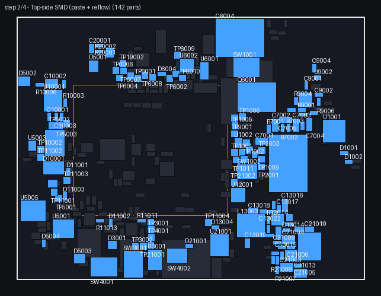

142 parts (142 top / 0 bottom)

| ref | value | package | sheet |
|---|---|---|---|
| C6004 | 470u | RVT1H471M1213 | esc_power |
| C7001 | 1n | C_1206_3225Metric | ethernet |
| C7002 | 1n | C_1206_3225Metric | ethernet |
| C7003 | 1n | C_1206_3225Metric | ethernet |
| C7004 | 1n | C_1206_3225Metric | ethernet |
| C7005 | 1n | C_1206_3225Metric | ethernet |
| C9001 | 100n | C_0603_1608Metric | microsd |
| C9002 | 100n | C_0603_1608Metric | microsd |
| C9004 | 100n | C_0603_1608Metric | microsd |
| C10001 | 100n | C_0603_1608Metric | pd_input |
| C10002 | 10u | C_1210_3225Metric | pd_input |
| C10003 | 47n | C_0603_1608Metric | pd_input |
| C13014 | 100n | C_0603_1608Metric | power_som |
| C13015 | 10u | C_1206_3216Metric | power_som |
| C13016 | 10u | C_1206_3216Metric | power_som |
| C13017 | 100n | C_0603_1608Metric | power_som |
| C13018 | 22u | C_0805_2012Metric | power_som |
| C13019 | 22u | C_0805_2012Metric | power_som |
| C13022 | 1u | C_0603_1608Metric | power_som |
| C13023 | 1u | C_0603_1608Metric | power_som |
| C13025 | 100n | C_0603_1608Metric | power_som |
| C20001 | 10u | C_0805_2012Metric | usb_uart_connector |
| C21003 | 4u7/100V | C_1210_3225Metric | vbat_supply |
| C21004 | 4u7/100V | C_1210_3225Metric | vbat_supply |
| C21005 | 100n/100V | C_0603_1608Metric | vbat_supply |
| C21006 | 100n/100V | C_0603_1608Metric | vbat_supply |
| C21007 | 1u | C_0603_1608Metric | vbat_supply |
| C21008 | 1u | C_0603_1608Metric | vbat_supply |
| C21009 | 100n | C_0603_1608Metric | vbat_supply |
| C21010 | 22u | C_0805_2012Metric | vbat_supply |
| C21011 | 22u | C_0805_2012Metric | vbat_supply |
| C21013 | 4u7/100V | C_1210_3225Metric | vbat_supply |
| D1001 | green | LED_0603_1608Metric | board_control |
| D1002 | red | LED_0603_1608Metric | board_control |
| D3001 | NUP2105LT1G | NUP2105LT1G | can_bus |
| D5001 | SRV05-4 | SOT-23-6 | esc_io |
| D5002 | SRV05-4 | SOT-23-6 | esc_io |
| D5003 | SRV05-4 | SOT-23-6 | esc_io |
| D5004 | blue | LED_0603_1608Metric | esc_io |
| D6004 | red | LED_0603_1608Metric | esc_power |
| D10001 | SMBJ22A | D_SMB | pd_input |
| D11001 | red | LED_0603_1608Metric | power |
| D11002 | red | LED_0603_1608Metric | power |
| D11003 | red | LED_0603_1608Metric | power |
| D13004 | red | LED_0603_1608Metric | power_som |
| D21001 | red | LED_0603_1608Metric | vbat_supply |
| L13003 | 10uH | SWPA8040S100MT | power_som |
| L21001 | 10uH | SWPA8040S100MT | vbat_supply |
| Q6001 | IPT007N06N | IPT007N06N | esc_power |
| R7001 | 75R | R_0603_1608Metric | ethernet |
| R7002 | 75R | R_0603_1608Metric | ethernet |
| R7003 | 75R | R_0603_1608Metric | ethernet |
| R7004 | 75R | R_0603_1608Metric | ethernet |
| R9001 | 100k | R_0603_1608Metric | microsd |
| R9002 | 100k | R_0603_1608Metric | microsd |
| R9003 | 100k | R_0603_1608Metric | microsd |
| R9004 | 100k | R_0603_1608Metric | microsd |
| R9005 | 100k | R_0603_1608Metric | microsd |
| R9006 | 10k | R_0603_1608Metric | microsd |
| R10003 | 100k | R_0603_1608Metric | pd_input |
| R10004 | 5.49k | R_0603_1608Metric | pd_input |
| R10005 | 5.1k | R_0603_1608Metric | pd_input |
| R10006 | 100k | R_0603_1608Metric | pd_input |
| R11011 | 10R | R_0603_1608Metric | power |
| R11013 | 10R | R_0603_1608Metric | power |
| R13014 | 47.5k | R_0603_1608Metric | power_som |
| R13015 | 13k | R_0603_1608Metric | power_som |
| R13018 | 22k | R_0603_1608Metric | power_som |
| R13019 | 1k | R_0603_1608Metric | power_som |
| R20001 | 5.1k | R_0603_1608Metric | usb_uart_connector |
| R20002 | 5.1k | R_0603_1608Metric | usb_uart_connector |
| R21007 | 22k | R_0603_1608Metric | vbat_supply |
| R21008 | 47.5k | R_0603_1608Metric | vbat_supply |
| R21009 | 6.8k | R_0603_1608Metric | vbat_supply |
| R21010 | 1k | R_0603_1608Metric | vbat_supply |
| SW1001 | DIP-4 | DSHP04TSGER | board_control |
| SW1002 | USER | TS-1187A-B-A-B | board_control |
| SW3001 | DIP-4 | DSHP04TSGER | can_bus |
| SW4001 | DIP-4 | DSHP04TSGER | debug_boot |
| SW4002 | RESET | TS-1187A-B-A-B | debug_boot |
| SW5001 | DIP-4 | DSHP04TSGER | esc_io |
| T7001 | HX5008NLT | HX5008NLT | ethernet |
| TP1001 | XP16 | TestPoint_Pad_D1.5mm | board_control |
| TP1002 | XP17 | TestPoint_Pad_D1.5mm | board_control |
| TP1005 | STM32_I2C2_SCL | TestPoint_Pad_D1.5mm | board_control |
| TP1006 | STM32_I2C2_SDA | TestPoint_Pad_D1.5mm | board_control |
| TP1007 | +3V3_SC | TestPoint_Pad_D1.5mm | board_control |
| TP1008 | SC_INT_N | TestPoint_Pad_D1.5mm | board_control |
| TP1009 | PUDC_34 | TestPoint_Pad_D1.5mm | board_control |
| TP1010 | +5V_FAN | TestPoint_Pad_D1.5mm | board_control |
| TP1011 | ESC_PWR_REQ | TestPoint_Pad_D1.5mm | board_control |
| TP2001 | EN_5V0 | TestPoint_Pad_D1.5mm | bringup_en |
| TP2002 | EN_3V3 | TestPoint_Pad_D1.5mm | bringup_en |
| TP2003 | EN_1V8 | TestPoint_Pad_D1.5mm | bringup_en |
| TP3001 | CAN_H | TestPoint_Pad_D1.5mm | can_bus |
| TP3002 | CAN_L | TestPoint_Pad_D1.5mm | can_bus |
| TP4001 | VBUS_OUT_EN | TestPoint_Pad_D1.5mm | debug_boot |
| TP5001 | +5V_MOTOR_IO | TestPoint_Pad_D1.5mm | esc_io |
| TP5002 | ESC_BIAS | TestPoint_Pad_D1.5mm | esc_io |
| TP5003 | OE_BUF_N | TestPoint_Pad_D1.5mm | esc_io |
| TP6001 | +VESC_IN | TestPoint_Pad_D1.5mm | esc_power |
| TP6002 | +VESC | TestPoint_Pad_D1.5mm | esc_power |
| TP6003 | GND_MOTOR | TestPoint_Pad_D1.5mm | esc_power |
| TP6004 | GND | TestPoint_Pad_D1.5mm | esc_power |
| TP6005 | +VESC_F | TestPoint_Pad_D1.5mm | esc_power |
| TP6006 | +VESC_MID | TestPoint_Pad_D1.5mm | esc_power |
| TP6007 | +VESC_P | TestPoint_Pad_D1.5mm | esc_power |
| TP6008 | ESC_PWR_EN | TestPoint_Pad_D1.5mm | esc_power |
| TP6009 | PROT_IMON | TestPoint_Pad_D1.5mm | esc_power |
| TP6010 | VSENSE_DIV | TestPoint_Pad_D1.5mm | esc_power |
| TP9001 | SDIO_CMD | TestPoint_Pad_D1.5mm | microsd |
| TP9002 | SDIO_CLK | TestPoint_Pad_D1.5mm | microsd |
| TP10001 | +VBUS_IN | TestPoint_Pad_D1.5mm | pd_input |
| TP10002 | +VIN_PD | TestPoint_Pad_D1.5mm | pd_input |
| TP11001 | +5V | TestPoint_Pad_D1.5mm | power |
| TP11002 | +3V3 | TestPoint_Pad_D1.5mm | power |
| TP11003 | +1V8 | TestPoint_Pad_D1.5mm | power |
| TP11004 | GND | TestPoint_Pad_D1.5mm | power |
| TP13001 | +5V_SOM | TestPoint_Pad_D1.5mm | power_som |
| TP19001 | ZYNQ_PS_UART0_TXD | TestPoint_Pad_D1.5mm | uart_bridge |
| TP19002 | ZYNQ_PS_UART0_RXD | TestPoint_Pad_D1.5mm | uart_bridge |
| TP21001 | +VBAT_SW | TestPoint_Pad_D1.5mm | vbat_supply |
| TP21002 | +VPRE | TestPoint_Pad_D1.5mm | vbat_supply |
| TP21003 | +VIN | TestPoint_Pad_D1.5mm | vbat_supply |
| TP21004 | +VBAT_D | TestPoint_Pad_D1.5mm | vbat_supply |
| U1001 | TCA9535PWR | TCA9535PWR | board_control |
| U1002 | SY6280AAC | SY6280AAC | board_control |
| U3001 | TCAN1042HGVDR | TCAN1042HGVDR | can_bus |
| U5001 | SN74HCT245PWR | SN74HCT245PWR | esc_io |
| U5003 | SY6280AAC | SY6280AAC | esc_io |
| U5005 | SN74LVC125ADR | SN74LVC125ADR | esc_io |
| U6001 | INA237AIDGSR | INA237AIDGSR | esc_power |
| U6002 | LM74930QRGERQ1 | LM74930QRGERQ1 | esc_power |
| U9001 | TXS02612RTWR | TXS02612RTWR | microsd |
| U9002 | TPD6E001RSER | TPD6E001RSER | microsd |
| U10001 | TPS26631PWPR | TPS26631PWPR | pd_input |
| U10002 | USBLC6-2SC6 | USBLC6-2SC6 | pd_input |
| U12001 | INA3221AIRGVR | INA3221AIRGVR | power_mon |
| U13004 | LM61460AANRJRR | LM61460AANRJRR | power_som |
| U20001 | USBLC6-2SC6 | USBLC6-2SC6 | usb_uart_connector |
| U21001 | TPS26631PWPR | TPS26631PWPR | vbat_supply |
| U21002 | LM61460AANRJRR | LM61460AANRJRR | vbat_supply |

NOTES: diode polarity (14 parts, D refs): cathode per silkscreen
NOTES: pin-1 orientation (18 parts, U/Q refs): dot per silkscreen

### Step 3 — Through-hole (short-to-tall)

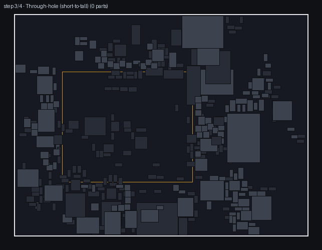

No parts in this step on this board.

### Step 4 — Connectors + mechanical hardware

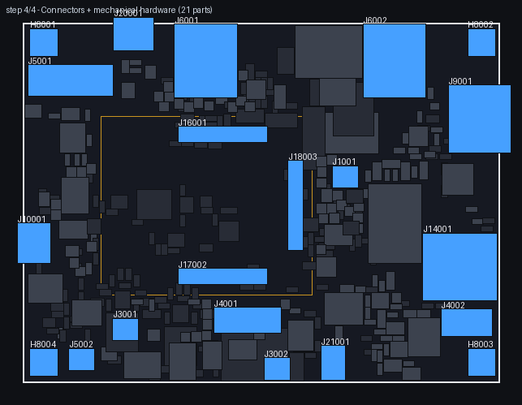

21 parts (21 top / 0 bottom)

| ref | value | package | sheet | joint |
|---|---|---|---|---|
| H8001 | MountingHole_M3 | MountingHole_3.2mm_M3_Pad | mechanical | THT |
| H8002 | MountingHole_M3 | MountingHole_3.2mm_M3_Pad | mechanical | THT |
| H8003 | MountingHole_M3 | MountingHole_3.2mm_M3_Pad | mechanical | THT |
| H8004 | MountingHole_M3 | MountingHole_3.2mm_M3_Pad | mechanical | THT |
| J1001 | ZX-SH1.0-4PWT | ZX-SH1.0-4PWT | board_control | SMD |
| J3001 | ZX-SH1.0-4PWT | ZX-SH1.0-4PWT | can_bus | SMD |
| J3002 | ZX-SH1.0-4PWT | ZX-SH1.0-4PWT | can_bus | SMD |
| J4001 | 878311420 | 878311420 | debug_boot | THT |
| J4002 | HX_JN1.27-2x5 | HX_JN1.27-2x5_TP_H4.9 | debug_boot | SMD |
| J5001 | HX PZ2.54-3x8P ZZ | HX_PZ2.54-3x8P_ZZ | esc_io | THT |
| J5002 | ZX-SH1.0-4PWT | ZX-SH1.0-4PWT | esc_io | SMD |
| J6001 | XT60PW-M | XT60PW-M | esc_power | THT |
| J6002 | XT60PW-M | XT60PW-M | esc_power | THT |
| J9001 | TF-01A | TF-01A | microsd | SMD |
| J10001 | TYPE-C-31-M-12 | TYPE-C-31-M-12 | pd_input | SMD |
| J14001 | KH-5224-8P8C-D | KH-5224-8P8C-D | rj45_connector | THT |
| J16001 | DF40C-100DP-0.4V(51) | HRS_DF40C-100DP-0.4V_51_ | som_j1 | SMD |
| J17002 | DF40C-100DP-0.4V(51) | HRS_DF40C-100DP-0.4V_51_ | som_j2 | SMD |
| J18003 | DF40C-100DP-0.4V(51) | HRS_DF40C-100DP-0.4V_51_ | som_j3 | SMD |
| J20001 | TYPE-C-31-M-12 | TYPE-C-31-M-12 | usb_uart_connector | SMD |
| J21001 | A2541WV-2x3P | PinHeader_2x03_P2.54mm_Vertical | vbat_supply | THT |

NOTES: J1001 ZX-SH1.0-4PWT: mating face toward the S board edge
NOTES: J3001 ZX-SH1.0-4PWT: mating face toward the S board edge
NOTES: J3002 ZX-SH1.0-4PWT: mating face toward the S board edge
NOTES: J5002 ZX-SH1.0-4PWT: mating face toward the S board edge
NOTES: J6001 XT60PW-M: mating face toward the N board edge
NOTES: J6002 XT60PW-M: mating face toward the N board edge
NOTES: J9001 TF-01A (microSD): mating face toward the E board edge
NOTES: J10001 TYPE-C-31-M-12 (PWR): mating face toward the W board edge
NOTES: J14001 KH-5224-8P8C-D (ETH): mates from above
NOTES: J20001 TYPE-C-31-M-12 (UART): mating face toward the N board edge
NOTES: XT60 pair: J6001 () / J6002 () — IN/OUT per silkscreen label
NOTES: J16001, J17002, J18003: DF40C SoM receptacles — the SoM module mates onto them (bring-up section, mate phase)

